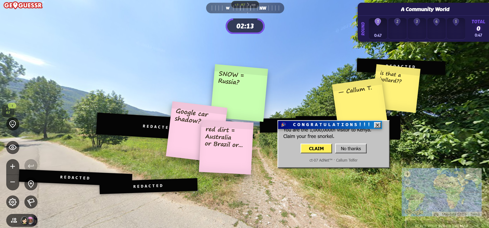
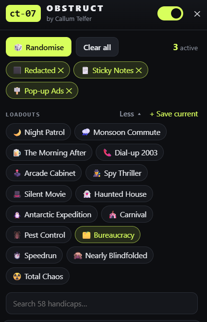
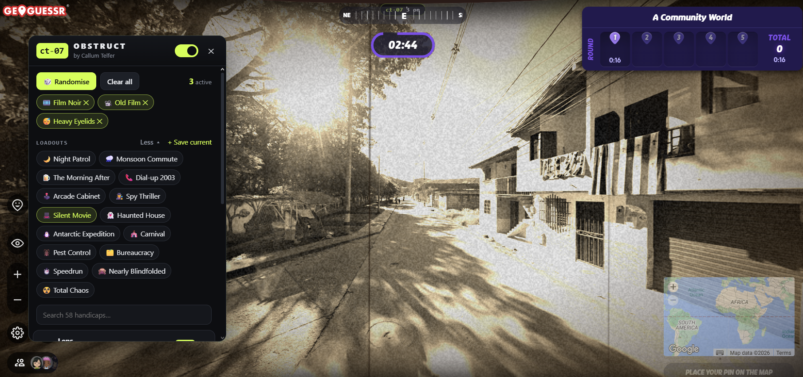
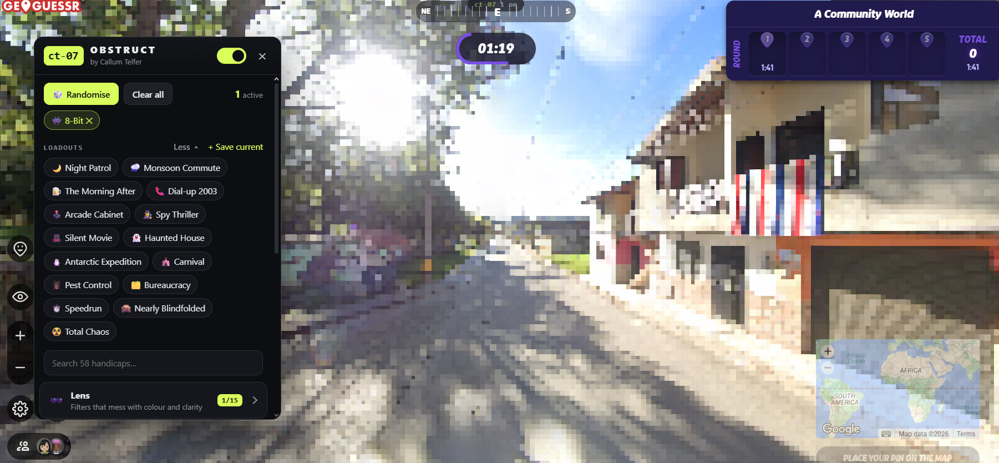
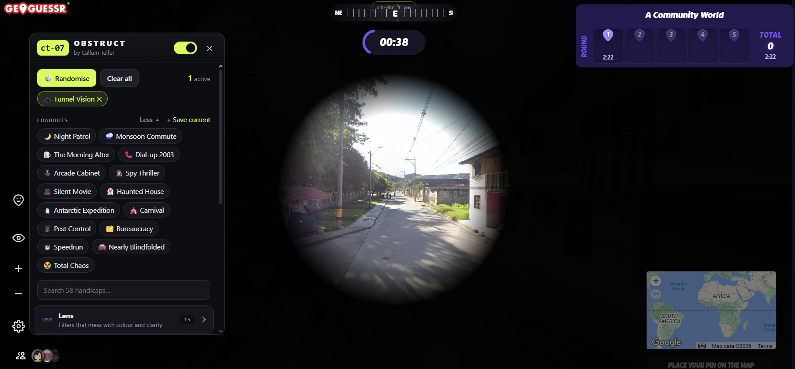
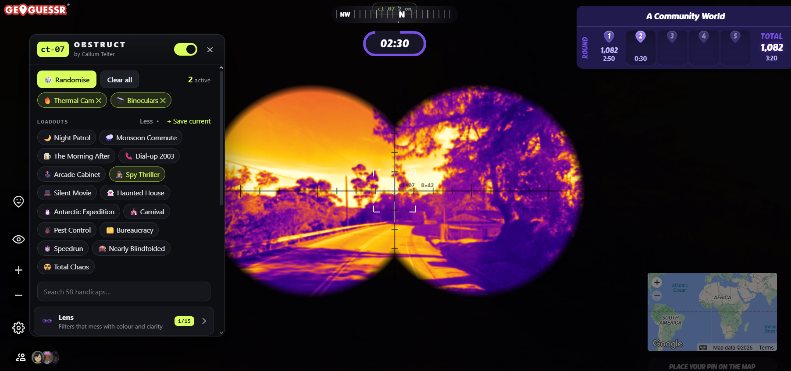

# ct-07 Obstruct

**Vision handicaps for GeoGuessr**

58 toggleable effects to make GeoGuessr harder: flashlights, blizzards, pop-up ads, drunk mode, thermal cameras, and more. Stack them, or pick one of 15 ready-made loadouts. Works in singleplayer and party games, and only on your own screen.

## Install

1. Download or clone this repo.
2. Open `chrome://extensions` (Opera: `opera://extensions`, Edge: `edge://extensions`, etc...) and turn on **Developer mode**.
3. Click **Load unpacked** and select the `ct07` folder.
4. Refresh any GeoGuessr game.

## Use

- **Toolbar popup:** click the ct-07 icon to toggle effects and tweak their settings (⚙).
- **In-game panel:** click the **ct 07** button on the left side of the screen, or press `Alt+Shift+O`.
- **Hotkeys:** `Alt+Shift+X` pause/resume · `Alt+Shift+R` random loadout · `Alt+Shift+C` clear all. You can also give any single effect its own hotkey.

## Effects

| Category | Examples |
|---|---|
| 🕶️ Lens | Thermal Cam, Night Vision, 8-Bit, Sketchbook, Colour Blind, Old Film, CRT |
| 👁️ Vision | Flashlight, Binoculars, Keyhole, Steamy Window, Scratch Card, Flash Round |
| 🌧️ Weather & Mess | Windshield Rain, Blizzard, Cracked Screen, Pop-up Ads, Bugs, DVD Logo |
| 🌀 Motion | Mirror World, Upside Down, Drunk, Earthquake, Seasick |
| 🧭 HUD | No Compass, Foggy Guess Map |
| 🎰 Chaos | Effect Roulette, Mystery Loadout, Escalation |

  
  

  
  

## NOT A CHEAT

Obstruct only makes the game harder. It never reads locations or touches guesses or scoring. Please keep it out of ranked modes to be safe.

---

Not affiliated with or endorsed by GeoGuessr.

ct-07 - Callum Telfer
